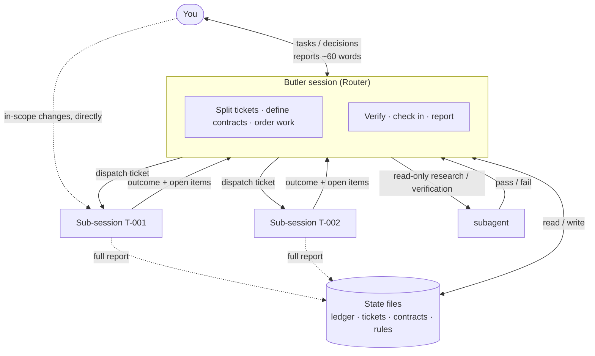
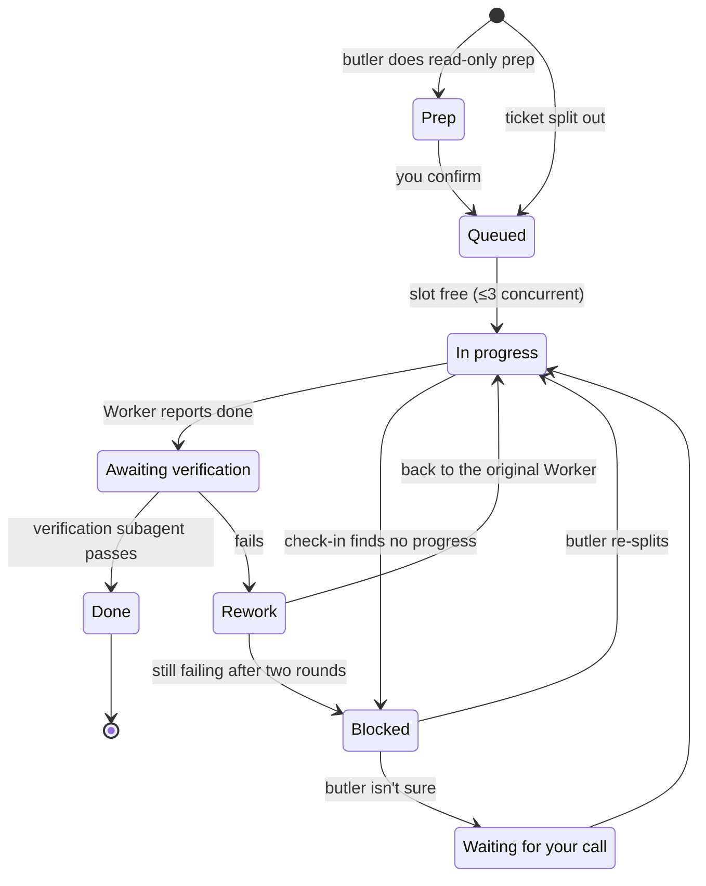

# butler: a super-agent for solo developers

**English** | [简体中文](README.zh-CN.md)

> A Claude Code skill that borrows DeepSeek's Router–Worker "super-agent" design for solo developers — no servers, no GitHub bots, just one butler session that plans, delegates, verifies and only asks you when it matters.

Type `/butler <task>` and the current session becomes the "butler": it splits the work into tickets, hands them out, verifies the results and reports back. Execution happens in separate sub-sessions or subagents, and the butler only comes to you when it genuinely needs a decision.

---

## What is a super-agent?

In October 2026, DeepSeek Harness published an architecture exploration, *Super-agent Design Exploration*, which splits an agent system into two layers:

- **Router**: one long-running session that receives messages, makes judgments, dispatches work and replies — but never executes anything itself (it doesn't even get a shell).
- **Workers**: several isolated execution sessions, each taking one task with the full toolset and the strongest model, and handing its conclusions back to the Router when done.

Supporting mechanisms include thread subscription (follow-up events on the same PR go straight to the Worker responsible), a Watchdog (periodically judging whether a Worker is actually making progress), Chain of Recall (objects reference each other by ID and are expanded on demand), and batched decisions. In their synthetic experiments, p95 completion time dropped from 29.5 minutes with a single session to 15.7 minutes, at the cost of several times more cache-read tokens.

That design targets **teams, 24/7, event-driven** settings: cloud containers, databases, daemons on every machine, GitHub and chat events wired in. The article itself calls it an exploration, not a product.

## What a solo developer can borrow

Solo developers usually have no PR stream or chat events to handle, and don't want a long-running agent holding credentials and acting on its own. The real pain points are two:

1. **One session gets messier the longer it runs**: planning and execution get mixed together, and the context fills up fast.
2. **When unsure, the agent either makes the call itself or asks about everything.**

So this project **borrows the design principles, not the infrastructure**:

| Super-agent practice | Adopted? | What it looks like in butler |
|---|---|---|
| The Router only coordinates, never executes | ✅ | The butler session writes only the ledger, tickets, contracts and rules under `.claude/butler/` — no project files, no builds, no screenshots |
| Enforce delegation by structure, not by encouraging prompts | ✅ | With a neutral prompt, DeepSeek's experiment saw 0 delegations in 5 runs, so here it's a hard rule |
| Isolated, parallel Workers | ✅ | Separate sub-sessions (worktrees in git projects), at most 3 at once |
| Ticket + Mandate | ✅ | One ticket per subtask, with an explicit mandate; external content can't widen it |
| Thread subscription, straight to the original Worker | ✅ | Rework and follow-ups go back to the original sub-session — no new session, no re-briefing through the butler |
| Chain of Recall / Inline & Spill | ✅ | The ledger is only an index; details live in ticket files, expanded by ID |
| Separate state from compute | ✅ | State lives in files; when a session fills up, open a new one and type `/butler continue` |
| Batched decisions | ✅ | Reports that arrive together are handled once and reported once |
| Watchdog | ✅ (simplified) | The butler checks in every time it wakes up, looking for "progress", not "still alive" |
| Interrupt the human only for decisions, briefly | ✅ | Reports are about 60 words, in three parts: outcome, needs your call, recommendation |
| Long-running processes, cloud containers, daemons | ❌ | Not needed for solo work, and a big security risk |
| Triggered automatically by GitHub / chat events | ❌ | Runs only while you're there, avoiding injection through external input |
| Peer-to-peer communication between Workers | ⚠️ Off by default | Authorized by the butler only for implementer ↔ reviewer loops or frontend ↔ backend interface alignment |

## How the butler works

### Overall structure



- The butler session holds only **conclusions**; change details, verification steps and acceptance records go in the ticket files.
- Sub-sessions don't talk to each other by default; they coordinate through **contract files** the butler writes up front.
- You can open any sub-session to watch or step in at any time — but you don't have to.

### Lifecycle of a ticket



### When it comes to you

| Tier | Covers |
|---|---|
| **Always asks first** | Writing to external systems, sending messages, deleting or overwriting, publishing or pushing (incl. git push / PRs), touching credentials, red lines in `rules.md`, going beyond scope or widening a mandate |
| **Asks with a recommendation** | Two reasonable approaches that affect what follows, still failing after two rounds of rework, substantive contract changes |
| **Decides, then tells you** | Reading code and docs, read-only queries, implementing per existing conventions, running / previewing / testing locally, rework and re-splitting |

## Install

### As a plugin (recommended)

In Claude Code:

```text
/plugin marketplace add veragao0101-cmd/butler-skill
/plugin install butler@butler-skill
```

Or from your shell:

```bash
claude plugin marketplace add veragao0101-cmd/butler-skill
claude plugin install butler@butler-skill
```

Then run it with `/butler <task>`. If another command already uses `/butler`, use the full name `/butler:butler`.

To update: `claude plugin marketplace update butler-skill`, then `claude plugin update butler@butler-skill`. Third-party marketplaces don't auto-update unless you turn it on under `/plugin` → Marketplaces.

### Manual install

Put the [`en/butler/`](en/butler/) folder in either location:

- For all projects: `~/.claude/skills/butler/`
- For one project only: `<project>/.claude/skills/butler/`

```bash
git clone https://github.com/veragao0101-cmd/butler-skill.git
cp -r butler-skill/en/butler ~/.claude/skills/
```

### Chinese edition

The Chinese edition lives in [`butler/`](butler/) and installs as the plugin `butler-zh@butler-skill`. Both editions provide a skill named `butler`, so install only one of them, and don't keep a manual copy alongside the plugin.

## Usage

```text
/butler Finish the login page per the design mockup, using the existing /api/auth endpoint
/butler continue
```

Butler mode starts only when you type `/butler` yourself; Claude never switches a session into it on its own.

On first use, the butler sets up `.claude/butler/` in your project:

| File | Purpose |
|---|---|
| `ledger.md` | Global index, one row per ticket |
| `rules.md` | Your project's red lines — **fill this in first** |
| `tickets/T-xxx.md` | Goal, mandate, acceptance criteria, report log |
| `contracts/C-xxx.md` | Fields, interfaces and conventions shared by several tickets |

In git projects, `.claude/butler/` comes with its own `.gitignore`, so it stays out of git and Workers' worktrees don't get stale copies. To commit the ledger as well, just delete that `.gitignore`.

**Recommended setup**: the Claude Code desktop app (Code tab) gives the fullest experience — separate sub-sessions, messages between them, and a sidebar to view each one. The terminal version has no separate sub-sessions, so the butler uses subagents instead; the rules stay the same.

## Limitations

- "The butler doesn't do the work itself" is a rule written into the skill, not technically enforced. If you need enforcement, add a PreToolUse hook that blocks writes from the butler session. Note that a hook in the project's `.claude/settings.json` applies to every session in the project, so Worker sub-sessions would be blocked too; hook input includes `session_id` and `cwd`, which you need to use to single out the butler session.
- Multiple sessions cost more tokens than one; in exchange you get parallelism and a butler session that doesn't fill up.
- DeepSeek's experiments used synthetic workloads and measured scheduling, not code quality, and this project hasn't been systematically evaluated yet either. Issues with real-world feedback are welcome.

## References

- [DeepSeek Harness: Exploring Super-agent Design](https://x.com/DeepSeekHarness/status/2116857257245987236)
- [offloop: Exploring DeepSeek Super Agent Design (full English translation)](https://offloop.org/learn/exploring-deepseek-super-agent-design)
- [kingy.ai: DeepSeek's Super-agent Design Explained](https://kingy.ai/blog/deepseek-super-agent-design-explained/)
- [redreamality: DeepSeek Super-agent Architecture](https://redreamality.com/blog/deepseek-super-agent-router-worker-architecture/)

## License

[MIT](LICENSE)
