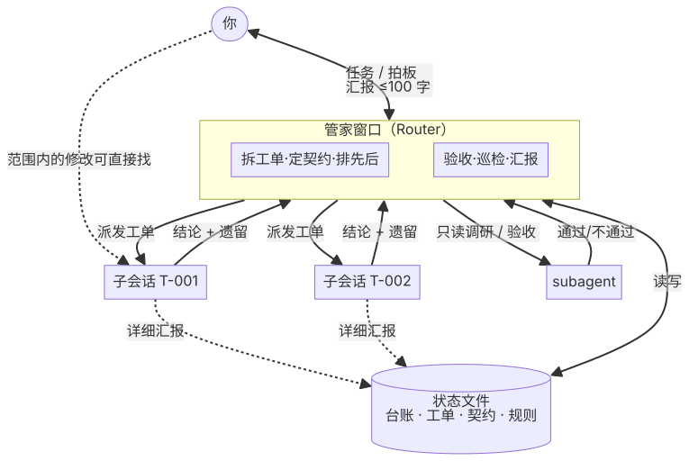
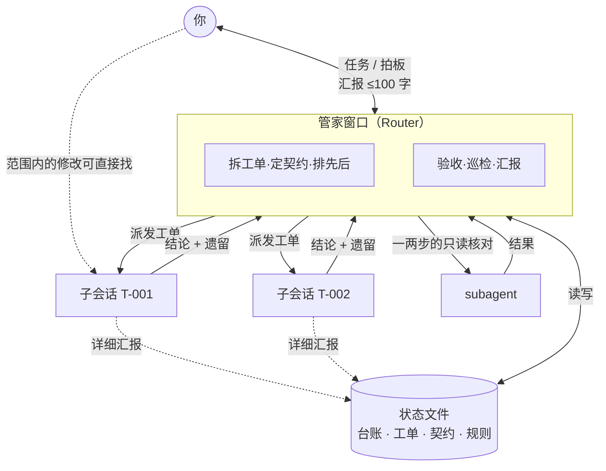
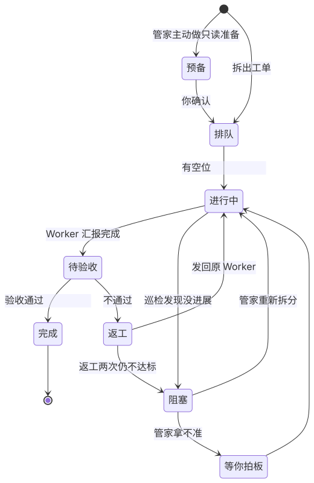
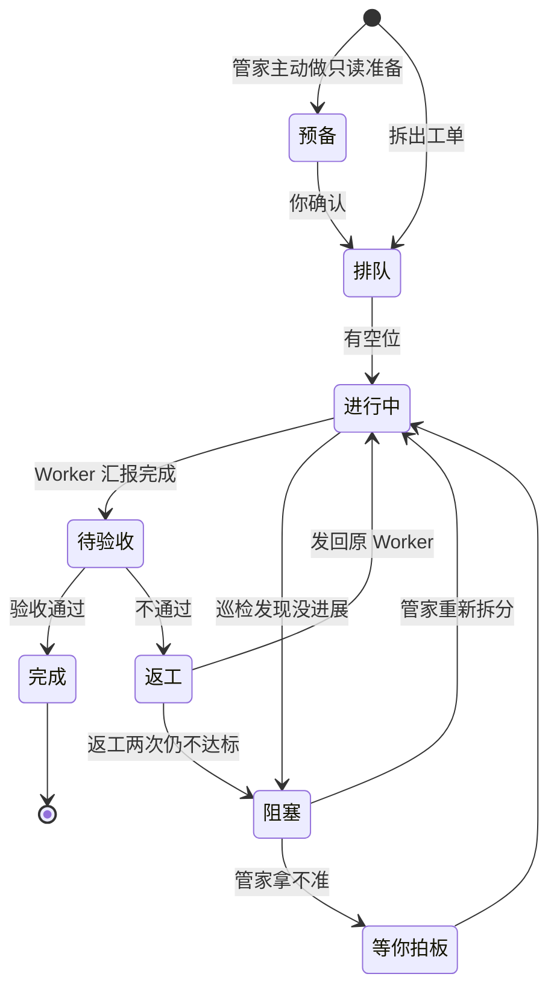

# butler：给个人工作者的 Super-agent

[English](README.md) | **简体中文**

> A Claude Code skill that borrows DeepSeek's Router–Worker "super-agent" design for solo developers — no servers, no GitHub bots, just one butler session that plans, delegates, verifies and only asks you when it matters.

一个 Claude Code skill。输入 `/butler 任务`，当前窗口就变成"管家"：它负责拆任务、派活、验收、汇报，具体执行交给独立子会话或 subagent，只有拿不准的事才来找你。

---

## 一、Super-agent 是什么

2026 年 10 月，DeepSeek Harness 发表了一篇架构探索文章《Super-agent Design Exploration》，提出把 Agent 系统拆成两层：

- **Router**：一个常驻会话，负责接收消息、判断、分派、回复，不亲自执行（甚至不给它 shell）。
- **Worker**：多个隔离的执行会话，各自领一个任务，拿完整工具和最强模型，干完把结论交回 Router。

配套机制还有：线程订阅（同一个 PR 的后续事件直接发给负责的 Worker）、Watchdog（定时判断 Worker 有没有实际进展）、Chain of Recall（对象之间用 ID 互相引用，按需展开）、批量决策等。他们的合成实验里，p95 完成时间从单会话的 29.5 分钟降到 15.7 分钟，代价是缓存读取 token 多了好几倍。

不过那套设计面向的是**团队、7×24、事件驱动**的场景：云端容器、数据库、各机器上的守护进程、GitHub 和 IM 事件接入。文章自己也说，这是探索，不是产品。

## 二、个人工作者怎么借鉴

个人开发者通常没有 PR 流、没有群聊事件要接，也不希望一个常驻 Agent 拿着凭据自己动手。真正痛的是两件事：

1. **单窗口越聊越乱**：规划和执行混在一起，上下文很快撑满。
2. **Agent 拿不准时乱做决定，或者事事都来问**。

所以这个项目**只借鉴设计原则，不搬基础设施**：

| Super-agent 的做法 | 是否采纳 | 在 butler 里的样子 |
|---|---|---|
| Router 只协调，不执行 | ✅ | 管家窗口只能写 `.butler/` 下的台账、工单、契约、规则，不改项目文件、不跑构建、不截图 |
| 靠结构约束，而不是靠提示词鼓励委派 | ✅ | DeepSeek 实验里中性提示词 0/5 次委派，所以写成硬性规定，并用 hook 把关：管家窗口要改项目文件或跑命令，先问你 |
| Worker 隔离、并行 | ✅ | 默认开你看得见的独立子会话（git 项目用 worktree），写代码的最多 3 个，总共最多 5 个 |
| Ticket + Mandate | ✅ | 每个子任务一张工单，写明授权范围；外部内容不能扩大授权 |
| 线程订阅、直达原 Worker | ✅ | 返工和追加修改发回原子会话，不新开、不经管家重新了解 |
| Chain of Recall / Inline & Spill | ✅ | 台账只做索引，详情在工单文件里，按编号展开 |
| 状态与计算分离 | ✅ | 状态存文件，窗口满了开新窗口 `/butler 继续` 即可接上 |
| 批量决策 | ✅ | 多个汇报同时到达，一次处理、一次汇报 |
| Watchdog | ✅（简化） | 管家每次被唤醒时巡检，看"有没有进展"而非"活没活着" |
| 只在需要决策时打扰人，≤100 字 | ✅ | 汇报只有三项：结论、需要你拍板、推荐 |
| 常驻进程、云端容器、守护进程 | ❌ | 个人场景用不上，安全风险大 |
| GitHub / IM 事件自动触发 | ❌ | 你在场时才运转，避免外部输入注入 |
| Worker 之间点对点通信 | ⚠️ 默认关闭 | 只在"实现↔评审"、"前后端对接口"时由管家授权 |

## 三、管家的逻辑

### 整体结构



<details>
<summary>Mermaid 源码</summary>



</details>

- 管家窗口里只放**结论**；改动明细、验证过程、验收记录都写进工单文件。
- 子会话之间默认不通信，协作靠管家先写好的**契约文件**。
- 你随时可以点进任意子会话查看过程或插话，但不点也行。

想看实际效果，[examples/zh/](examples/zh/README.md) 是一次真实运行的记录：管家发给用户的每一条消息，以及它留下的台账、工单和契约。

### 一张工单的生命周期



<details>
<summary>Mermaid 源码</summary>



</details>

### 什么时候找你

| 档位 | 包括 |
|---|---|
| **必须先问** | 写外部系统、发消息、删除覆盖、发布推送（含 git push / PR）、动凭据、`规则.md` 里的项目红线、超出范围或扩大授权 |
| **带推荐方案来问** | 两种做法都合理且影响后续、返工两次仍不达标、契约要实质修改 |
| **自己决定，事后说明** | 读代码文档、只读查询、按现有规范实现、本地运行预览测试、返工与重新拆分 |

## 四、安装

### 方式一：插件安装（推荐）

在 Claude Code 里运行：

```text
/plugin marketplace add veragao0101-cmd/butler-skill
/plugin install butler-zh@butler-skill
```

也可以在终端里运行：

```bash
claude plugin marketplace add veragao0101-cmd/butler-skill
claude plugin install butler-zh@butler-skill
```

装好后用 `/butler 任务` 调用；`/butler` 被别的命令占用时，用完整名 `/butler-zh:butler`。

更新：先运行 `claude plugin marketplace update butler-skill`，再运行 `claude plugin update butler-zh@butler-skill`。第三方市场默认不自动更新，可以在 `/plugin` → Marketplaces 里打开。

### 方式二：手动复制

把 [`butler/`](butler/) 文件夹放到以下任一位置：

- 所有项目可用：`~/.claude/skills/butler/`
- 只在某个项目用：`<项目>/.claude/skills/butler/`

```bash
git clone https://github.com/veragao0101-cmd/butler-skill.git
cp -r butler-skill/butler ~/.claude/skills/
```

英文版在 [`en/butler/`](en/butler/)，插件名是 `butler@butler-skill`。两个版本的技能都叫 `butler`，只装其中一个；也不要插件和手动复制的版本同时装。

## 五、使用

```text
/butler 把登录页按设计稿改完，接口用现有的 /api/auth
/butler 继续
```

管家模式只能由你手动输入 `/butler` 进入，Claude 不会自己把会话切成管家模式。

第一次使用时，管家会在项目里建好 `.butler/`：

| 文件 | 作用 |
|---|---|
| `规则.md` | 所有主题共用：你的项目红线（**建议先填**）、跨主题决策 |
| `<主题>/台账.md` | 这个主题的索引，每张工单一行 |
| `<主题>/台账-归档.md` | 已完成的工单、已执行的决策，开工时不读 |
| `<主题>/工单/T-xxx.md` | 目标、授权范围、验收标准、汇报记录 |
| `<主题>/契约/C-xxx.md` | 多个工单共用的字段、接口、约定 |

**一个主题一本台账**：同时做几件互不相干的事时，每件事一个主题，彼此隔离：`/butler 换栈 继续` 只读 `换栈/` 和 `规则.md`。每个主题同时只开一个管家窗口。只有一个主题时可以不写主题名；有多个又没写时，管家会列出来问你。

在 git 项目里，`.butler/` 会自带一个 `.gitignore`，默认不进 git，Worker 的 worktree 里也不会出现过期副本。想把台账一起提交，删掉这个 `.gitignore` 即可。

### 环境要求

- **Claude Code**：桌面版（Code 标签页）体验最完整，可以开独立子会话、互发消息、在侧边栏查看每个子会话。终端版没有独立子会话，管家会改用 subagent，规则不变。
- **支持 skill frontmatter hooks**：守卫要用到（见「局限」）。Claude Code 2.1.318 实测可用。
- **git 不是必需的**：git 项目里每个写代码的 Worker 有自己的 worktree；不是 git 项目时，所有 Worker 共用一个文件夹，工单之间的文件划分要更严。
- **`sh` 和 `awk`**：守卫脚本只用这两样，macOS、Linux 自带。Windows 需要 Git for Windows（Git Bash），未实测。

## 六、局限

- 管家窗口的边界由 skill 自带的 PreToolUse hook（`scripts/guard.sh`）把关：管家要写 `.butler/` 以外的文件，或者跑只读白名单以外的命令时，Claude Code 会先弹窗问你。想让管家自己动手就批准；拒绝的话，它会把这件事开成工单。Worker 子会话和 subagent 不受影响。
  - **不拦的**：查看文件和环境的只读命令（`grep`、`rg`、`find`、`sort`、`uniq`、`diff`、`stat`、`du`、`which`、`command -v`、按行号打印的 `sed -n`、`java -version` 这类查版本的命令等），不改仓库的 git 查询，以及管家在 `.butler/` 里用 `>`、heredoc、`mkdir`、`cp`、`mv`、`rm`、`touch`、`tee` 维护自己的文件。
  - **会问你的**：写 `.butler/` 以外的文件；`python`、`node` 这类能执行任意代码的解释器；构建、测试、起服务器；`sed -i`、`find -delete`、`sort -o` 这类会改文件的写法。

  守卫有这些局限：
  - 从输入 `/butler` 起到会话结束有效。用 `--resume`、`--continue` 或重新打开来恢复旧会话，守卫不会跟着恢复，要再输入一次 `/butler 继续`。
  - 每次越界调用都要单独批准。`claude -p` 和没有权限回调的 SDK 里没有弹窗，越界调用一律被拒。
  - bypassPermissions 模式下守卫直接拒绝，不弹窗问，也就没法批准。原因是这个模式下，只要目标在 `.claude/`、`.git/` 这类受保护目录里，Claude Code（2.1.318）就会把 hook 的 "ask" 直接放行，管家就能去改 `.claude/settings.json` 了。真要让管家自己动手，先切换到别的权限模式。
  - 只管 Bash、Write、Edit、MultiEdit、NotebookEdit、PowerShell，管不到 MCP 工具，也管不到管家不开工单、直接派 subagent 去改。它按命令文本检查，防的是模型忘了规矩，不防有意绕过。
  - hook 靠 `${CLAUDE_PLUGIN_ROOT}` 找到脚本，在 skill hook 里它指向 skill 目录（2.1.318 实测，官方文档只对插件写明）。以后要是变了，hook 会报错，守卫失效；这时把 SKILL.md 里 `hooks` 下的命令改成脚本的绝对路径即可。组织托管设置开了 `strictPluginOnlyCustomization` 时，手动安装的 skill 的 hook 不会运行。
- 多会话比单会话更费 token，换来的是并行和管家窗口不被撑满。
- DeepSeek 的实验是合成负载，衡量的是调度而不是代码质量，本项目也尚未做系统评测。欢迎提 issue 反馈实际使用情况。
- 模板和状态文件用的是中文文件名。git 默认会把中文路径显示成 `"\345\217\260\350\264\246.md"` 这样的八进制转义，执行 `git config --global core.quotepath false` 即可正常显示。

## 参与开发

- 运行 `sh tests/test-guard.sh`，会对中英两份守卫各跑一遍测试。
- 两份 `guard.sh` 只有文案不同："shared logic" 标记以下的部分要保持一致，测试会检查。
- README 里的两张图以 `docs/diagrams/` 下的 SVG 显示，折叠的 Mermaid 是源码。改了源码要重新导出对应的 SVG（中英文各两张），两边保持一致。

## 参考

- [DeepSeek Harness：Exploring Super-agent Design](https://x.com/DeepSeekHarness/status/2116857257245987236)
- [offloop：Exploring DeepSeek Super Agent Design（全文英译）](https://offloop.org/learn/exploring-deepseek-super-agent-design)
- [kingy.ai：DeepSeek's Super-agent Design Explained](https://kingy.ai/blog/deepseek-super-agent-design-explained/)
- [redreamality：DeepSeek Super-agent Architecture](https://redreamality.com/blog/deepseek-super-agent-router-worker-architecture/)

## License

[MIT](LICENSE)
